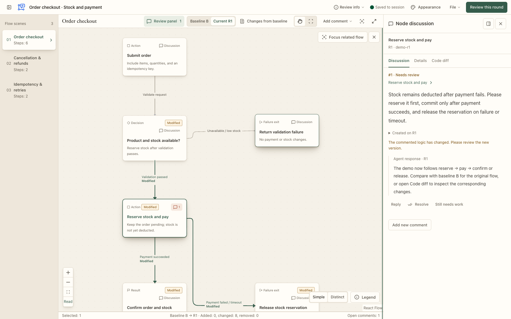
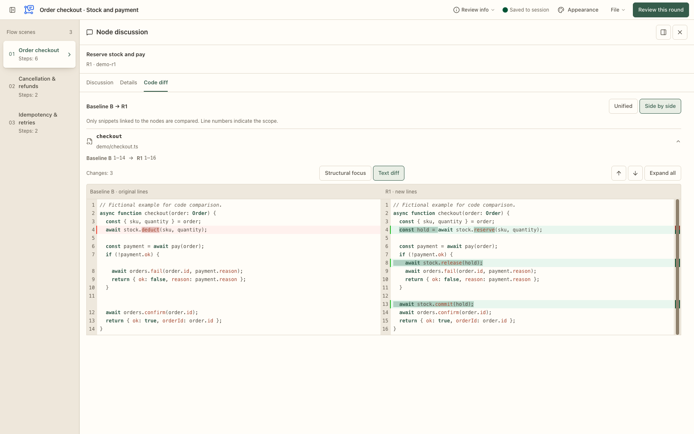

<p align="center">
  <strong>English</strong> · <a href="README.zh-CN.md">简体中文</a>
</p>

<p align="center">
  
</p>

<h1 align="center">LogicMargin</h1>

<p align="center">
  <strong>Build with AI. Understand what it builds.</strong>
</p>

<p align="center">
  A local logic review tool: follow the flow, inspect the code, leave feedback, and verify each revision.
</p>

<p align="center">
  <a href="package.json"></a>
  <a href="#quickstart"></a>
  <a href="docs/agent-workflow.md"></a>
</p>

<p align="center">
  <a href="#why-logicmargin">Why LogicMargin?</a> ·
  <a href="#about">About</a> ·
  <a href="#preview">Preview</a> ·
  <a href="#quickstart">Quickstart</a> ·
  <a href="#documentation">Documentation</a>
</p>

## Why LogicMargin?

AI is helping more people write more code, but understanding and reviewing that code has not become equally fast.

- **For developers, faster output means more code to review.** An agent can change many files and generate substantial code in one pass. Developers still need to understand call relationships, conditions, failure handling, and state changes. A line-by-line diff makes it difficult to reconstruct the full business flow and spot omissions or side effects.
- **For people without a programming background, AI makes building possible while the code can remain a black box.** Product managers, designers, and domain experts can describe a requirement and get a working feature, yet struggle to tell how it executes, what happens on failure, or whether it matches their intent. A working screen and the AI's explanation offer limited evidence of correctness.

“Can a failed operation still charge a fee?” “Could a repeated claim grant the reward twice?” “Does cancellation restore the previous state?” Answering these questions requires understanding the system's actual behavior and checking it again after a change.

## About

LogicMargin brings flowcharts, related code, and review discussions into one local interface for people and coding agents. People without a programming background can start with flows and business rules; developers can open the corresponding source and diffs. Both can review the behavior of the same implementation.

An agent reads the actual code or documents and prepares a flowchart. You annotate specific nodes, edges, or groups of objects. After you submit a round, the agent changes the implementation, updates the diagram, and replies to the original feedback. You compare the revision with the fixed baseline and decide whether the issue is resolved. Feedback, replies, and versions stay together across rounds.

Agent-prepared diagrams still need to be checked against the source. LogicMargin provides tools for reading, discussing, and verifying the work; people make the final judgment.

## Preview

<picture>
  <source media="(prefers-color-scheme: dark)" srcset="docs/images/review-dark-en.png" />
  <source media="(prefers-color-scheme: light)" srcset="docs/images/review-light-en.png" />
  
</picture>

<p align="center">
  Fixed baseline · Changes on the diagram · Node discussions<br />
  <a href="docs/images/review-light-en.png">Light theme</a> ·
  <a href="docs/images/review-dark-en.png">Dark theme</a> ·
  <a href="docs/examples/order-review.en.logic-margin.json">Download the English demo</a>
</p>

<picture>
  <source media="(prefers-color-scheme: dark)" srcset="docs/images/code-diff-dark-en.png" />
  <source media="(prefers-color-scheme: light)" srcset="docs/images/code-diff-light-en.png" />
  
</picture>

<p align="center">
  Discussion, Details, and Code diff · Resizable sidebar · Side-by-side source comparison<br />
  <a href="docs/images/code-diff-light-en.png">Light code view</a> ·
  <a href="docs/images/code-diff-dark-en.png">Dark code view</a>
</p>

Screenshots from the 0.9.0 Go build use fictional order data and sample code. The code view shows the earlier text/structural focus switch; the current interface automatically applies structural focus when available and otherwise keeps the text diff. The downloadable demo includes a fixed baseline and saved code snippets; it contains no real review sessions and does not demonstrate production source verification.

## Features

| Capability | What you can do |
| --- | --- |
| **Review directly on the diagram** | Comment on nodes, edges, multiple objects, a whole scenario, or the entire review, with the relevant flow in view. |
| **Read beside a node** | Switch between Discussion, Details, and Code diff in one window to inspect discussion history, rules, inputs, outputs, and source evidence. Keep it beside the node or dock it in the right sidebar. |
| **Inspect related code changes** | Use unified or side-by-side diffs of saved node source snippets, with line numbers, syntax highlighting, change navigation, and unchanged-region folding. A single vertical scrollbar combines removal and addition markers with the reading position; click or drag it to navigate the current snippet. Buttons at the beginning and end of each visible block repeatedly reveal up to 20 more lines; you can also reveal one entire unchanged region or show the full snippet. |
| **See changes across rounds** | Compare the first review revision R1 and later rounds against the fixed original baseline B, see additions, removals, and modifications on the diagram, or inspect field changes against the previous round. Return to the original location of a removed target. |
| **Plan changes on the original system** | Annotate baseline B with redesign requirements, then review the agent's implementation in R1 alongside the original diagram and comments. |
| **Work with a coding agent** | Submit a round explicitly, let the agent wait, revise, reply, and publish a new diagram, then verify or approve the result yourself. |
| **Separate review purposes** | Associate multiple independent reviews with one agent conversation while keeping their comments, drafts, and rounds separate. |
| **Control your data** | Import and export JSON, download full backups, archive and restore reviews, or explicitly delete them. Optional automatic archival follows approval. |

Choose from three themes—paper, soft relief, and glass—with light, dark, or system appearance. Code comparison defaults to side by side; choose unified or side by side in the code view or Settings. The layout is saved in the browser and retained across nodes, scenarios, and reloads. The interface works on desktop and mobile. On desktop, drag either sidebar's boundary to resize it; the right sidebar can expand over the canvas for longer discussions and side-by-side code.

The interface supports **English and Simplified Chinese**. It initially follows the browser’s supported language; choose **Settings → Interface → Interface language** to save a different preference. Flows, source code, and comments stay in their original language, and switching languages keeps your current selection and drafts.

Settings opens in a centered window with **Interface**, **Keyboard shortcuts**, and **Version and updates** tabs. Common review actions have configurable shortcuts: record a replacement, disable a binding, or restore defaults. Typing and IME composition keep their normal behavior. See the [default keys and customization guide](docs/keyboard-shortcuts.md).

Code diffs compare related source snippets saved in the review’s fixed baseline B and revision R when their correspondence can be established. If a historical snippet is missing or the pairing is ambiguous, the interface shows the available source and an explanation. It does not infer old code from the current workspace or provide a repository-wide diff. During local source verification, the Go CLI also captures version-verified full files in an optional backend analysis cache. Structural analysis uses that context and projects results back into the saved snippets; full files are not included in review JSON or sent to the browser. Missing or evicted context retains the existing snippet/text fallback.

Structural focus is applied automatically for supported Go and JavaScript/TypeScript syntax, including JSX/TSX, once a valid analysis is ready. It emphasizes changes beyond safe formatting differences and offers a local comparison with the original location for clearly paired moved blocks, including blocks modified during the move. Source text, alignment, and unified/side-by-side layouts are preserved. Unsupported syntax, uncertain pairing, or exhausted budgets automatically retain text highlighting with an explanation; no manual mode switch is needed. This is a syntax-based reading aid; it does not use the SemanticDiff engine or prove general semantic equivalence. See the [structural diff contract and validation](docs/structural-diff.md).

## Quickstart

**0.9.6 uses a Go executable with the web UI embedded. Users do not need Node.js, Go, Bun, or npm.** Online Codex installation requires Git and internet access to download the matching native release on first launch. Node.js and Go are development/build tools only.

### Use it with an agent

For **DeepSeek Harness 0.2.2-rc.1**, build and install the dedicated tgz following the [DSH guide](docs/deepseek-harness.md). It registers the skill and connects the same native service through DSH's official MCP Client. The Codex commands below are specific to Codex.

Register the Git marketplace and install the plugin:

```sh
codex plugin marketplace add SunneeYang/LogicMargin --ref main --sparse .agents/plugins --sparse plugins/logic-margin
codex plugin add logic-margin@logic-margin-local
```

Codex checks out the plugin directories. Their `.sh` / `.ps1` launchers download the native ZIP for your platform from the official GitHub Release, pinned to the plugin version, and verify its SHA-256 before running it. Start a new agent session in the project you want to review:

```text
$logic-margin:logic-margin
Start a logic review for the current feature. Focus on whether failures
can still deduct a fee, and wait for my feedback.
```

The agent starts one background process for HTTP MCP, the review API, and the bundled web UI. On first use, `server setup` registers its local MCP address and long tool timeout in Codex; reconnect or reload MCP in your host and verify that its tools are available. The agent then reads the sources, prepares the diagram, and gives you a review link. Later reviews reuse the same process. Your business project does not need LogicMargin's npm dependencies.

Before updating an existing installation, identify its managed service with `server status`, stop the verified old instance with `server stop`, and back up the actual session directory. Then ask your agent to run:

```sh
codex plugin marketplace upgrade logic-margin-local
codex plugin add logic-margin@logic-margin-local
```

Keep the same `LOGIC_MARGIN_HOME` / `LOGIC_MARGIN_DATA_DIR`, port, and session IDs. After updating, load the new skill and CLI path, restart the service, and reconnect MCP; use `server setup` if registration needs repair. Review data stays separate from the plugin cache; do not delete it to upgrade. See the [upgrade steps](docs/agent-plugin.md#升级与数据连续性). The marketplace follows its registered ref; it does not poll for updates during a review.

For installation without Git, use [Release v0.9.6](https://github.com/SunneeYang/LogicMargin/releases/tag/v0.9.6). Choose `logic-margin-agent-0.9.6-TARGET.zip` and its `.zip.sha256`:

| Platform | TARGET |
| --- | --- |
| macOS Apple Silicon | `darwin-arm64` |
| macOS Intel | `darwin-x64` |
| Linux ARM64 | `linux-arm64` |
| Linux x64 | `linux-x64` |
| Windows x64 | `win32-x64` |

Each ZIP contains one native executable and the plugin files. It runs directly from `plugins/logic-margin/skills/logic-margin/scripts/logic-margin` (`logic-margin.exe` on Windows), with no runtime download. See the [plugin guide](docs/agent-plugin.md) for checksum verification, ZIP registration, and service upgrades. The detailed guides are currently in Chinese.

### Try it in your browser

For source development, clone the repository and run from its root:

```sh
npm ci
npm run dev
```

Open **http://127.0.0.1:5173**. Browse the built-in examples, or choose “File → Import review” and select the [English order demo JSON](docs/examples/order-review.en.logic-margin.json) to try baseline comparison, node discussions, and code diffs. A [Chinese demo](docs/examples/order-review.logic-margin.json) is also available.

The demo is for learning the interface. A real review should be generated from actual code or documents and include source evidence.

## Review workflow

There are two starting points: **review existing changes** by preparing the original baseline B and the changed revision R1, or **plan a system redesign** by annotating B before the agent implements and publishes R1. Later rounds retain the same baseline for comparison.

| Step | Action |
| --- | --- |
| **1 · Start** | The agent prepares a diagram for one explicit review purpose, records its source snapshot, opens an independent review, and waits. |
| **2 · Annotate** | Inspect branches, select objects, and leave comments on the diagram. Move longer comments to the side panel when needed. |
| **3 · Submit** | Submit the round to freeze the current feedback into a package for the waiting agent. |
| **4 · Revise** | The agent changes the code or documents, verifies the sources again, and publishes the updated diagram and final replies together. |
| **5 · Verify** | Compare the changes, read the original feedback and replies, then confirm resolution, add feedback, or approve the round. |

**Saving a comment and submitting a round are separate actions.** Saved session comments remain available before submission; the waiting agent continues after an explicit submission. A reply does not automatically resolve an issue. The reviewer makes the final decision.

The agent reads sources, changes code, and prepares diagrams. LogicMargin displays, discusses, stores, and tracks the review. Its MCP wait tool holds the request until a submission, approval, or terminal error; ordinary comment saves and connection keep-alives require no model checks. Its server does not execute project code or shell commands, and it has no built-in language model.

## Independent reviews and cleanup

Continue the original review for changes serving the same purpose. Start a new review when the subject or purpose changes. Use MCP `context` to associate reviews with an agent conversation and `purpose` to describe what each review checks. The following CLI commands remain available for scripts; normal agent reviews use the corresponding MCP tools. Set `LM_CLI` to the installed native executable, or to the Git marketplace’s `scripts/logic-margin.sh` launcher. In PowerShell, set `$LM_CLI` to `logic-margin.exe` or `logic-margin.ps1` and invoke it with `& $LM_CLI`, for example `& $LM_CLI server status`.

```sh
# List active and archived reviews in one context
"$LM_CLI" list --context order-checkout --state all

# Archive by default, preserving the full diagram, comments, and history
"$LM_CLI" cleanup SESSION_ID

# Restore an archived review
"$LM_CLI" restore SESSION_ID

# Permanently delete one review; it cannot be restored from the server
"$LM_CLI" cleanup SESSION_ID --mode delete
```

“File → Review tasks” also provides creation, backup, archive, restore, and deletion actions. By default, only approved reviews can be cleaned up. See the [agent workflow](docs/agent-workflow.md#查询归档与删除) for explicit cleanup of unfinished reviews, command options, and concurrency checks.

MCP `wait_review` does not claim feedback or archive reviews. After reading feedback, the agent calls `acknowledge_review`. With `cleanup_on_approval`, it calls `cleanup_review` only after receiving final approval; new feedback prevents cleanup using an old version. Rounds, comments, and history have no fixed business count limits; individual content and single-request resource checks still apply.

<details>
<summary><strong>Where is the data stored? How do I access it from another device?</strong></summary>

- **Shared reviews:** diagrams, comments, replies, and history live on the service machine. Managed services default to `~/.logic-margin/sessions`; the development server uses `.logic-margin/sessions` in the repository. The actual directory is configurable.
- **Browser data:** unfinished drafts, pending operations, and standalone file reviews are stored in the current browser for the current origin. They do not automatically appear on other devices.
- **Private network access:** the development server listens on `0.0.0.0:5173` by default. Other LAN devices can use the machine's LAN address. With Tailscale, set the review link's public address to the service machine's Tailscale address.
- **MCP access:** the MCP endpoint accepts loopback connections only, even when the review page is shared over a private network. The MCP service and source workspace are on the same machine.
- **Current boundaries:** the review API is intended for a trusted local machine or private network. Remote MCP, accounts, permissions, and multiuser collaboration are not implemented. Source digest verification also does not replace human verification of the diagram's meaning.

</details>

## Documentation

The detailed guides below are currently in Chinese.

| Topic | Start here |
| --- | --- |
| Plugin installation, automatic startup, distribution, and platform entry points | [Agent plugin](docs/agent-plugin.md) |
| DeepSeek Harness package, isolated validation, and market submission paths | [DSH integration](docs/deepseek-harness.md) |
| Starting, waiting, replying, publishing revisions, and cleanup | [Agent workflow](docs/agent-workflow.md) |
| Diagram JSON, stable IDs, and source digests | [Review format](plugins/logic-margin/skills/logic-margin/references/review-format.md) |
| Cross-round comparison, carried comments, and original locations | [Revision review design](docs/revision-review-design.md) |
| Synchronization, rendering, and measurement boundaries | [Performance optimization](docs/performance-optimization.md) |
| Real sources and coverage of the built-in examples | [Psycho-skill example](docs/sample-source.md) · [Spirit Sanctum](docs/spirit-sanctum-source.md) |

<details>
<summary><strong>Local development and validation</strong></summary>

Requires the Node.js version supported by `package.json` tooling and the Go version in `go.mod`. Wrap builds and tests that create substantial temporary data with the repository’s `agent-tmp-run` harness.

```sh
npm ci
npm run dev         # UI development with the legacy Node API
npm test            # Frontend/model tests and legacy Node compatibility oracle
npm run build       # TypeScript checks and frontend build
npm run build:go    # Native Go service with embedded UI
npm run test:go     # Go runtime tests
npm run test:go:agent  # Native distribution integration tests
npm run test:go:compat # Node/Go compatibility checks

npx playwright install chromium
npm run test:go:e2e # Go service with desktop/mobile viewport and theme tests
```

If Chrome is already installed, you can also run `PLAYWRIGHT_CHANNEL=chrome npm run test:go:e2e`.

Built with React 19, TypeScript, React Flow, Vite, and a local Go HTTP service. The legacy Node backend is retained as a developer compatibility oracle. See the [plugin guide](docs/agent-plugin.md#开发与验证) for native builds and [migration validation](docs/go-backend-validation.md) for the historical test scope. Five-target cross-compilation is separate from native acceptance; the migration record reports actual execution on macOS ARM64 only.

</details>

## Acknowledgements

LogicMargin is available under the [MIT license](LICENSE). Distribution archives include the project license and retain their third-party notices.

Special thanks to **[Crit](https://github.com/tomasz-tomczyk/crit)** for inspiring the workflow of browser annotations, explicit submissions, and agents waiting for review. LogicMargin draws on these interaction patterns and independently implements diagram annotations, cross-round verification, and review task management around business flows and logical relationships. Primary sources and design decisions are recorded in the [Crit reference notes](docs/crit-reference.md).

Thanks to **[React Flow / xyflow](https://github.com/xyflow/xyflow)** for the diagram canvas foundation.

Thanks to **[CodeMirror](https://codemirror.net/)** and **[@codemirror/merge](https://github.com/codemirror/merge)** for the code editor and diff foundation, including syntax highlighting, unified and side-by-side comparison, and change navigation. LogicMargin adds node source pairing, incremental context expansion, change overview navigation, and virtualized unified diffs for long snippets. License notices are included in [THIRD_PARTY_NOTICES.md](plugins/logic-margin/THIRD_PARTY_NOTICES.md).
