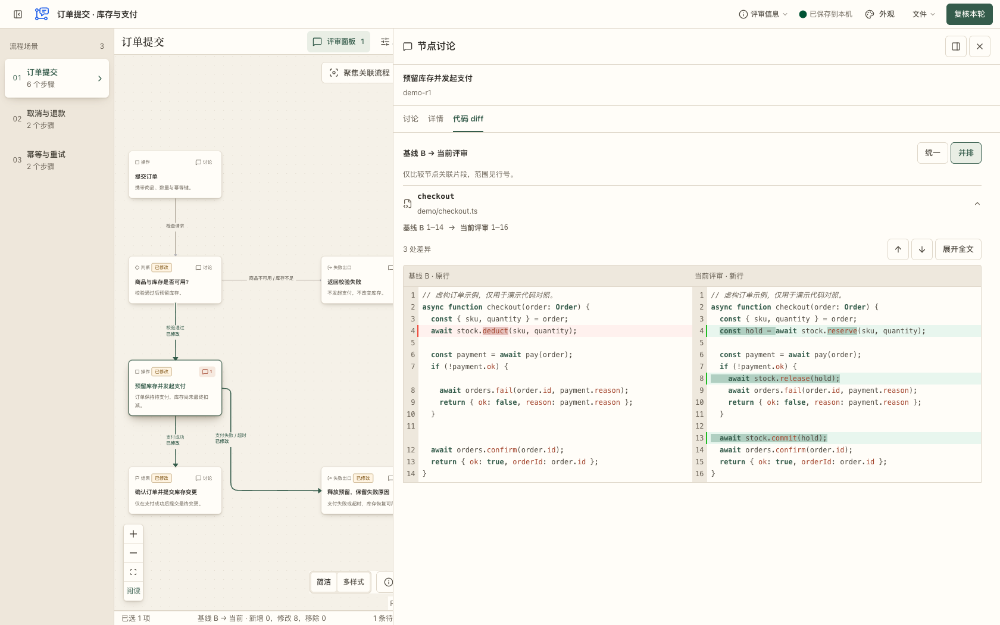

<p align="center">
  <a href="README.md">English</a> · <strong>简体中文</strong>
</p>

<p align="center">
  
</p>

<h1 align="center">LogicMargin · 逻辑旁批</h1>

<p align="center">
  <strong>和 AI 一起写代码，也能看清它做了什么。</strong>
</p>

<p align="center">
  本地运行的逻辑评审工具：看流程、查代码、留批注，逐轮确认修改。
</p>

<p align="center">
  <a href="package.json"></a>
  <a href="#快速开始"></a>
  <a href="docs/agent-workflow.md"></a>
</p>

<p align="center">
  <a href="#为什么需要-logicmargin">为什么需要</a> ·
  <a href="#这是什么">项目简介</a> ·
  <a href="#界面预览">界面预览</a> ·
  <a href="#快速开始">快速开始</a> ·
  <a href="#文档">文档</a>
</p>

## 为什么需要 LogicMargin

AI 正在让越来越多的人写出越来越多的代码，但理解和审查代码并没有同样变快。

- **对技术人员，代码产出更快，审查负担更重。** Agent 一次就可能修改多个文件、生成大量代码。开发者仍要读懂调用关系、判断条件、异常处理和状态变化；逐行看 diff，很难快速建立完整的业务流程，确认改动有没有遗漏或副作用。
- **对非技术人员，能用 AI 编程，代码却仍可能是黑盒。** 产品、策划和业务人员可以描述需求、让 AI 做出能运行的功能，却不一定知道内部怎样执行、失败时怎样处理、是否真正符合预期。仅凭界面效果和 AI 的解释，很难判断实现是否可靠。

例如：“失败时还会扣费吗？”“重复领取会不会多发奖励？”“取消操作后，状态是否恢复？”这些问题需要看清系统的实际行为，修改后还要能复核。

## 这是什么

LogicMargin 把流程图、相关代码和评审讨论放在同一处，为人与编程 Agent 提供一个本地运行的逻辑评审界面。非技术人员可以从流程和业务规则入手，技术人员可以继续展开源码与 diff，两者围绕同一份实现核对行为。

Agent 从实际代码或文档整理流程图，你在具体节点、连线或一组对象上批注。提交本轮意见后，Agent 修改实现、更新图并回复原意见；你再对照固定基线和新版，确认问题是否解决。意见、回复和版本保留在一起，便于追踪每轮修改。

流程图由 Agent 整理，仍需核对是否忠实反映源码；LogicMargin 提供阅读、讨论与复核工具，最终判断由人完成。

## 界面预览

<picture>
  <source media="(prefers-color-scheme: dark)" srcset="docs/images/review-dark.png" />
  <source media="(prefers-color-scheme: light)" srcset="docs/images/review-light.png" />
  
</picture>

<p align="center">
  固定基线 · 图上变更标记 · 节点讨论<br />
  <a href="docs/images/review-light.png">查看明亮主题</a> ·
  <a href="docs/images/review-dark.png">查看深色主题</a> ·
  <a href="docs/examples/order-review.logic-margin.json">下载中文演示数据</a>
</p>

<picture>
  <source media="(prefers-color-scheme: dark)" srcset="docs/images/code-diff-dark.png" />
  <source media="(prefers-color-scheme: light)" srcset="docs/images/code-diff-light.png" />
  
</picture>

<p align="center">
  讨论／详情／代码 diff · 可调宽侧栏 · 并排源码对照<br />
  <a href="docs/images/code-diff-light.png">查看浅色代码对照</a> ·
  <a href="docs/images/code-diff-dark.png">查看深色代码对照</a>
</p>

截图来自 0.8.5 源码页面，使用虚构订单流程和示例代码。演示文件包含固定基线与已保存的代码片段，不含真实业务会话，也不代表生产源码核验结果。

## 核心能力

| 能力 | 你可以做什么 |
| --- | --- |
| **直接在图上评审** | 对节点、连线、多个对象、整个场景或整张图留下意见，讨论始终带着流程上下文。 |
| **在节点旁展开阅读** | 在同一窗口切换“讨论／详情／代码 diff”，查看讨论历史、规则、输入输出和源码依据；可在节点旁浮窗与右侧栏之间切换。 |
| **核对相关代码改动** | 对已保存的节点源码片段使用统一或并排 diff，查看行号与语法高亮、跳转差异、折叠未变内容。 |
| **看见每轮变化** | 从第一次评审版本 R1 开始对照固定的原版基线 B，在图上查看增删改，也可相对上一轮核对字段差异；节点移除后，原意见仍可回到历史位置查看。 |
| **先讨论原系统改造** | 直接在基线 B 上批注改造要求，Agent 修改实现后发布 R1，保留原图与意见供复核。 |
| **与 Agent 完成闭环** | 明确提交本轮意见，Agent 等待、修改、回应并发布新图，再由人确认解决或通过。 |
| **按目的隔离任务** | 同一段对话可关联多个独立评审；不同目的的批注、草稿与轮次分别保留。 |
| **掌握数据的去留** | JSON 导入导出、完整备份、可恢复归档与显式永久删除；支持完成后自动归档。 |

提供“纸页审阅、柔光浮雕、清透玻璃”三种主题，均可选择浅色、深色或跟随系统，支持桌面与手机浏览。桌面左右侧栏可拖动调宽，右侧栏可继续展开覆盖画布，方便阅读较长讨论和并排代码。

界面支持**简体中文和英文**，首次使用根据浏览器语言选择，也可在**外观 → 界面语言**中切换并保存偏好。流程、代码和批注保留原文；切换语言会保留当前选择与草稿。

代码 diff 比较的是评审中保存且能匹配的相关源码片段。缺少历史片段或无法确定对应关系时，界面显示已有原文和原因；不会用当前代码推测旧版本，也不提供全仓库 diff。

## 快速开始

需要 **Node.js 22.18+**，推荐 24+。Codex 在线安装还需要 Git；无需手动克隆仓库、安装本工程的 npm 依赖或构建插件。

### 交给 Agent 使用

注册远程 marketplace，安装已构建的插件：

```sh
codex plugin marketplace add SunneeYang/LogicMargin --ref main --sparse .agents/plugins --sparse plugins/logic-margin
codex plugin add logic-margin@logic-margin-local
```

Codex 管理 Git 检出，只展开插件目录。在需要评审的业务工程中新开 Agent 会话：

```text
$logic-margin:logic-margin
为当前功能发起逻辑评审，重点检查失败时是否会扣费，并等待我的批注。
```

Agent 启动一个后台进程，同时提供 HTTP MCP、评审 API 和内嵌网页。首次用 `server setup` 注册本机 MCP 地址和长工具超时，再按宿主提示重载或重连 MCP，核实工具可用后读取来源、整理流程图并给出评审链接。后续评审复用同一后台，业务工程无需安装 LogicMargin 的 npm 依赖。

更新时，可以让 Agent 执行：

```sh
codex plugin marketplace upgrade logic-margin-local
codex plugin add logic-margin@logic-margin-local
```

随后新开会话，加载新版技能和 CLI 路径。评审数据独立于插件缓存保存。这会更新到 `main` 上已构建的版本；评审过程中不会后台轮询升级。

不想依赖 Git 时，可从 [GitHub Releases](https://github.com/SunneeYang/LogicMargin/releases/latest) 下载 Node 小包及 SHA-256 校验文件。ZIP 安装、从本地 marketplace 迁移、服务重启与可选原生包见 [插件安装文档](docs/agent-plugin.md)。

### 在浏览器中体验

进行源码开发时，克隆仓库后在根目录运行：

```sh
npm ci
npm run dev
```

打开 **http://127.0.0.1:5173**。可直接浏览内置样例，或从“文件 → 导入评审”选择 [订单演示 JSON](docs/examples/order-review.logic-margin.json)，体验基线对照、节点讨论和代码 diff；也提供 [英文演示](docs/examples/order-review.en.logic-margin.json)。

演示数据用于熟悉交互；真实评审应从实际代码或文档生成流程，并补齐来源依据。

## 评审如何进行

可以从两个起点开始：**审查已有改动**时，准备原版基线 B 与改动后的 R1；**规划系统改造**时，先在基线 B 上提出要求，Agent 实现后再发布 R1。后续轮次保留同一份基线，便于持续对照。

| 步骤 | 操作 |
| --- | --- |
| **1 · 发起** | Agent 按一个明确的审查目的生成流程图，记录来源快照，打开独立评审任务并等待。 |
| **2 · 圈选** | 你在图上查看分支、圈选对象、添加批注；长意见可移到侧栏继续编辑。 |
| **3 · 提交** | 点击“提交本轮”，把当前意见固定成提交包，交给等待中的 Agent。 |
| **4 · 修改** | Agent 修改代码或文档，重新核验来源，将新版流程图与最终回应一起发布。 |
| **5 · 复核** | 你对照前后变化，查看原意见与回应，确认解决、补充意见或确认整轮通过。 |

**保存批注与提交本轮是两个动作。** 已保存的会话批注不会因未提交而消失；等待中的 Agent 在收到明确提交后才继续。回复也不会自动解决意见，最终确认由评审者完成。

Agent 负责读源、改代码和整理流程；LogicMargin 负责呈现、讨论、保存与复核。MCP 等待工具持续挂起，直到人工提交、确认通过或终态错误；普通批注保存与连接保活不需要模型反复检查。服务端不执行项目代码或 shell，也没有内置大模型。

## 独立任务与清理

同一目的的修改沿用原任务的轮次；更换审查对象或目的时，新建任务。MCP 用 `context` 关联同一段 Agent 对话，用 `purpose` 明确本次核对什么。以下兼容 CLI 命令供脚本使用，正常 Agent 评审使用对应 MCP 工具。

```sh
# 查询同一上下文中的活动与归档任务
npm run review -- list --context order-checkout --state all

# 默认归档，保留完整图、批注和历史
npm run review -- cleanup <sessionId>

# 恢复归档任务
npm run review -- restore <sessionId>

# 明确永久删除指定任务，无法从服务端恢复
npm run review -- cleanup <sessionId> --mode delete
```

网页“文件 → 评审任务”也提供建立、备份、归档、恢复和删除入口。默认仅清理已通过的任务；未完成任务的显式清理、命令参数与并发保护见 [Agent 工作流](docs/agent-workflow.md#查询归档与删除)。

MCP `wait_review` 不领取、不归档；Agent 实际读取意见后用 `acknowledge_review` 领取。设置 `cleanup_on_approval` 后，实际取得最终批准才调用 `cleanup_review`；期间出现新意见会阻止旧版本清理。轮次、批注和历史不设固定业务条数上限，仍保留单条内容及单次请求的资源校验。

<details>
<summary><strong>数据保存在哪里？如何从另一台设备访问？</strong></summary>

- **共享任务**：流程、批注、回复与历史保存在服务所在机器。托管服务默认使用 `~/.logic-margin/sessions`，开发服务使用工程的 `.logic-margin/sessions`；可配置实际目录。
- **浏览器内容**：尚未添加的草稿、待同步操作和独立文件模式的数据保存在当前浏览器、当前访问地址，不会自动出现在其他设备上。
- **私有网络访问**：开发服务默认监听 `0.0.0.0:5173`；局域网设备可使用本机的局域网地址。使用 Tailscale 时，将评审链接地址设置为服务机器的 Tailscale 地址。
- **MCP 访问**：即使网页分享到私有网络，MCP 也只接受本机回环连接，与需核验的源码工作区位于同一机器。
- **使用边界**：评审 API 面向受信任的本机或私有网络，尚未提供账号和权限管理。来源摘要校验也不能代替对流程语义的人工复核。

</details>

## 文档

| 我想了解… | 从这里开始 |
| --- | --- |
| 插件安装、自动启动、分发与跨平台入口 | [Agent 插件](docs/agent-plugin.md) |
| 发起、等待、回复、发布新版和清理 | [Agent 工作流](docs/agent-workflow.md) |
| 流程图 JSON、稳定 ID 与来源摘要 | [评审文件格式](plugins/logic-margin/skills/logic-margin/references/review-format.md) |
| 跨轮对比、批注迁移与原位置 | [跨轮评审设计](docs/revision-review-design.md) |
| 同步、渲染和测量边界 | [性能优化](docs/performance-optimization.md) |
| 内置样例的真实源码与覆盖范围 | [通灵样例](docs/sample-source.md) · [魔灵秘境](docs/spirit-sanctum-source.md) |

<details>
<summary><strong>本地开发与验证</strong></summary>

```sh
npm ci
npm run dev         # 网页与评审 API
npm test            # 模型、客户端、CLI 与服务端测试
npm run build       # TypeScript 检查与生产构建
npm run test:agent  # 分发包集成测试

npx playwright install chromium
npm run test:e2e    # 桌面、移动端与系统明暗主题的交互测试
```

已有 Chrome 时也可运行 `PLAYWRIGHT_CHANNEL=chrome npm run test:e2e`。

技术栈：React 19、TypeScript、React Flow、Vite，以及基于 Node.js 的本地 HTTP 服务。默认 Node 分发包不内嵌运行时；可选 Bun 原生包的构建说明见 [插件文档](docs/agent-plugin.md#开发与验证)。

</details>

## 致谢

特别感谢 **[Crit](https://github.com/tomasz-tomczyk/crit)** 为浏览器批注、明确提交与 Agent 等待评审的工作流提供启发。LogicMargin 借鉴这些交互机制，围绕业务流程节点与逻辑关系，自行实现图上批注、跨轮复核与评审任务管理。相关主源与设计取舍记录在 [Crit 参考说明](docs/crit-reference.md)。

感谢 **[React Flow / xyflow](https://github.com/xyflow/xyflow)** 提供流程图画布基础。
